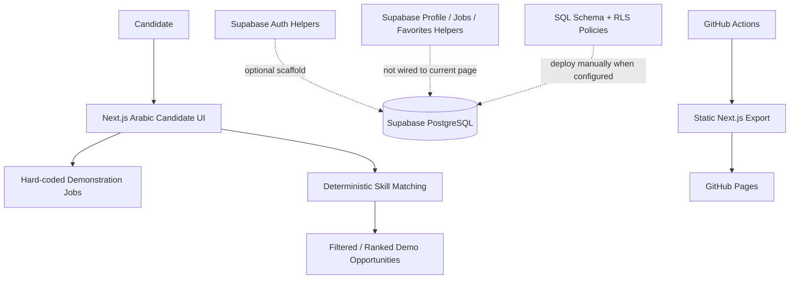

# InWork — Remote Work & Home-Based Opportunity MVP

[](https://nextjs.org/)
[](https://react.dev/)
[](https://www.typescriptlang.org/)
[](.github/workflows/ci.yml)
[](#proof-of-concept--enterprise-customization-readiness)

**InWork is a prototype for matching job seekers with remote, home-based, part-time, and freelance opportunities using a simple profile and skills-based ranking.**

The current UI contains a guided Arabic candidate flow, hard-coded demonstration opportunities, local filtering, and a basic deterministic matching function. Supabase client/schema scaffolding exists for future authentication and persistence, but the current page is not yet connected to it. This is not a live job marketplace or a payment platform.

## 1. Project Overview & Problem Statement

People looking for flexible work often face fragmented listings, unclear fit, and onboarding forms that ask for too much before showing relevant opportunities. InWork explores a lightweight flow: collect a small candidate profile, identify skills and work preferences, and rank opportunities by a transparent skills match.

The current direction includes remote and home-based work categories such as virtual assistance, data entry, customer support, bookkeeping, social content, and home-based craft work.

The current repository is still a prototype and has not yet completed the product pivot into a fully women-focused work-from-home marketplace. The interface is generic and does not yet implement women-specific trust, safety, verification, privacy, or support workflows.

### Current architecture



### Implemented versus proposed

- Implemented: candidate wizard UI, in-memory candidate state, hard-coded demo job cards, client-side filters, favorite state for the current browser session, and deterministic skill matching logic.
- Present as scaffolding: Supabase client/auth/data helpers, SQL schema and row-level security policies.
- Not implemented: verified live job ingestion, employer portal, job moderation, real application submission, payments, payouts, location-based worker dispatch, or persistent candidate accounts on the current deployed static site.

## 2. Tech Stack & Versions

| Layer | Technology / declared version |
|---|---|
| Framework | Next.js 14.2.35 |
| UI | React 18, React DOM 18 |
| Language | TypeScript 5; some JavaScript / JSX modules |
| Styling | Tailwind CSS 3.4.1, PostCSS 8 |
| Data client | Supabase JS 2.109.0 range |
| Client state / data | Zustand 5.0.14, TanStack Query 5.101.4 |
| Forms / validation | React Hook Form 7.84.0, Zod 4.4.3 |
| HTTP / utilities | Axios 1.19.0, clsx 2.1.1, tailwind-merge 3.6.0 |
| Maps (declared) | Leaflet 1.9.4, React Leaflet 5.0.0 |
| Icons | lucide-react 1.28.0 |
| CI runtime | Node.js 20 |
| Deployment | Next.js static export + GitHub Pages |

Exact resolved package versions are recorded in [`package-lock.json`](package-lock.json). CI uses `npm ci --legacy-peer-deps`; retain this install mode unless the React/React-Leaflet peer dependency compatibility is reviewed and corrected.

## 3. Prerequisites & Dependencies

- Git.
- Node.js 20 (matches the current CI and Pages workflows).
- npm.
- A modern browser.
- Optional: a Supabase project if authentication and database-backed profiles/jobs/favorites are deliberately enabled in a future deployment.

The UI prototype can be built without Supabase credentials. The checked-in `.env.example` contains blank placeholders. No payment gateway credentials are required or supported by the current implementation.

## 4. Installation & Local Setup

Clone the repository:

```bash
git clone https://github.com/zopair/inwork-ai-repo.git
cd inwork-ai-repo
```

Install dependencies using the same mode as CI:

```bash
npm ci --legacy-peer-deps --no-audit --no-fund
```

Run the local development server:

```bash
npm run dev
```

Open `http://localhost:3000`.

### Production build

```bash
npm run lint
npm run build
```

### GitHub Pages static export

The Pages workflow sets `GITHUB_PAGES=true`, builds the static export into `out/`, and uploads that directory:

```bash
GITHUB_PAGES=true npm run build
```

The configured repository subpath is `/inwork-ai-repo`. Local development does not need that base path.

## 5. Environment Variables

The only documented Supabase variables are:

| Variable | Required? | Purpose |
|---|---|---|
| `NEXT_PUBLIC_SUPABASE_URL` | Optional for current UI; required to initialize Supabase client | Supabase project URL |
| `NEXT_PUBLIC_SUPABASE_ANON_KEY` | Optional for current UI; required to initialize Supabase client | Public anon key, subject to deployed RLS policies |

Copy the template if preparing a separately configured Supabase environment:

```bash
cp .env.example .env.local
```

The current GitHub Pages workflow does not pass these variables to the build. As a result, the exported static site does not have an initialized Supabase client, and authentication/database helper calls throw a configuration error if invoked.

Never place a Supabase service-role key, database password, payment credential, or private API token in a `NEXT_PUBLIC_*` variable or the public repository.

## 6. Usage Guide & Core Features

### Candidate experience

The current `src/app/page.tsx` provides a guided flow:

1. Introductory screen.
2. Prototype terms and disclaimer acknowledgement.
3. Basic candidate details.
4. Experience, skills, and English-language preference.
5. Demonstration opportunity results with text and category filters.
6. Free-text work-history entry screen.

### Matching logic

[`src/lib/matching.ts`](src/lib/matching.ts) contains a deterministic skills-based scoring function. It:

- Compares candidate skills with opportunity tags case-insensitively.
- Applies a small bonus for international opportunities when English is available.
- Excludes international opportunities when the candidate does not indicate English ability.
- Returns a sorted list of opportunity/score pairs.

This is a prototype ranking heuristic, not an AI model, employment assessment, or guarantee that a job is suitable or genuine.

### Data and authentication scaffolding

- `src/lib/supabase.ts` initializes the Supabase client only when both public environment variables exist.
- `src/lib/auth.ts` contains Google OAuth, sign-out, and session helpers.
- `src/lib/inwork-data.ts` contains profile, job recommendation, and favorite helpers.
- `supabase/schema.sql` defines `profiles`, `jobs`, and `favorites` with row-level security policies.
- `supabase/seed.sql` provides demonstration job records.

These helpers and SQL files are not evidence that a Supabase project has been provisioned, configured, or connected to the current UI.

### Legacy local-services artifacts

Some files still reflect an earlier Ismailia local-services marketplace concept:

- `src/components/UserRoleSelector.jsx` offers customer/craftsman roles.
- `src/api/handler.py` is a placeholder response for a local service request.
- `config/payments_and_maps.json` describes InstaPay/mobile-wallet and Leaflet settings.
- Older documents describe local craft services and payment flows.

The current UI and Supabase schema instead focus on candidate profiles and remote/job opportunities. The payment configuration does not implement a payment processor; the Python handler does not connect a customer to a real provider. Treat these legacy files as historical scaffolding, not active features.

## 7. Live Demo & Screenshots

The repository includes a GitHub Pages static-export workflow:

- [Configured Pages destination](https://zopair.github.io/inwork-ai-repo/)

The deployment workflow is configured to build with `GITHUB_PAGES=true` and publish `out/`. A current successful deployment was not confirmed in the workflow history reviewed for this README update; treat the URL as the configured destination until a successful deployment is verified.

No screenshots are included as proof of a live Supabase backend, authenticated user account, verified job listing, real employer, payment, or completed application.

## 8. Testing & Verification

### Available commands

```bash
npm run lint
npm run build
```

There is no `test` script in the current root `package.json` and no dedicated automated unit-test suite was found in the reviewed tree. The CI workflow currently runs lint and build.

### CI evidence observed during this review

- **In Work CI:** latest observed run on 17 November 2026 — Success.
- **Dependency Lock Sync and Verification:** latest observed run on 17 November 2026 — Success.
- **Security and Dependency Audit:** latest observed run on 17 November 2026 — Success, but the checked-in workflow step currently prints status messages and runs `node -v`; it does not execute a real vulnerability or secret scanner.
- **Pages deployment:** workflow definition is present; no recent successful deployment was confirmed in the reviewed run history.

The workflow success is historical evidence for the exact PR commit that ran. It is not proof of production deployment, Supabase connectivity, security certification, or live marketplace operation.

## Proof of Concept & Enterprise Customization Readiness

**Status: PoC / MVP — front-end prototype with optional backend scaffolding.**

| Area | Verified state / boundary |
|---|---|
| Candidate UI | Implemented Arabic-first guided flow |
| Opportunity data | Hard-coded demo records in the current page |
| Skill matching | Deterministic local scoring function |
| Supabase client | Optional client initialization scaffold |
| Authentication | Google OAuth helper functions; not wired into the current page and requires Supabase configuration |
| Database | SQL schema and RLS policies present; no connected production project verified |
| Job ingestion | No verified live job-board ingestion in this repository |
| Women-focused marketplace | Product direction not fully reflected in UI/data; dedicated workflows remain to be designed and validated |
| Payments / payouts | Not implemented; legacy payment configuration is not a gateway integration |
| Local services | Legacy Ismailia-oriented files remain and need a deliberate keep/remove decision |
| Hosting | Static export workflow configured; current deployment not verified |
| Automated tests | No dedicated unit-test suite or npm test script found |
| Security audit | Current workflow is an echo-only placeholder, not a security scanner |
| License | No root `LICENSE` file was present in the reviewed repository tree |

### Readiness gaps before a real launch

1. Confirm the product boundary: women-focused home-based opportunity marketplace versus general remote-work matching.
2. Replace hard-coded job cards with a source-verified, moderated job ingestion process and clear source/expiry metadata.
3. Connect Supabase only after provisioning the project, configuring OAuth redirects, applying migrations, and validating RLS policies.
4. Add tests for matching, profile validation, auth state, data access, and static export.
5. Remove or isolate legacy payment/local-services files; never present the current configuration as payment integration.
6. Replace the echo-only security workflow with actual, scoped dependency and secret checks.
7. Add clear job verification, reporting, privacy, user safety, and anti-fraud workflows.
8. Confirm license and third-party dependency terms before redistribution or commercial deployment.

Enterprise customization can add employer verification, moderated job feeds, candidate consent controls, role-based access, analytics, and integration adapters after the MVP scope and data-protection requirements are agreed.

## Intellectual Property & Authorship

Project authorship and attribution: **Aly Hussein Zopair (علي حسين زبير ALY HUSSEIN ZOPAIR)**.

This notice is an authorship attribution, not a software license or proof of legal registration. Third-party dependencies, fonts, map data, and other assets remain subject to their own licenses and terms.
